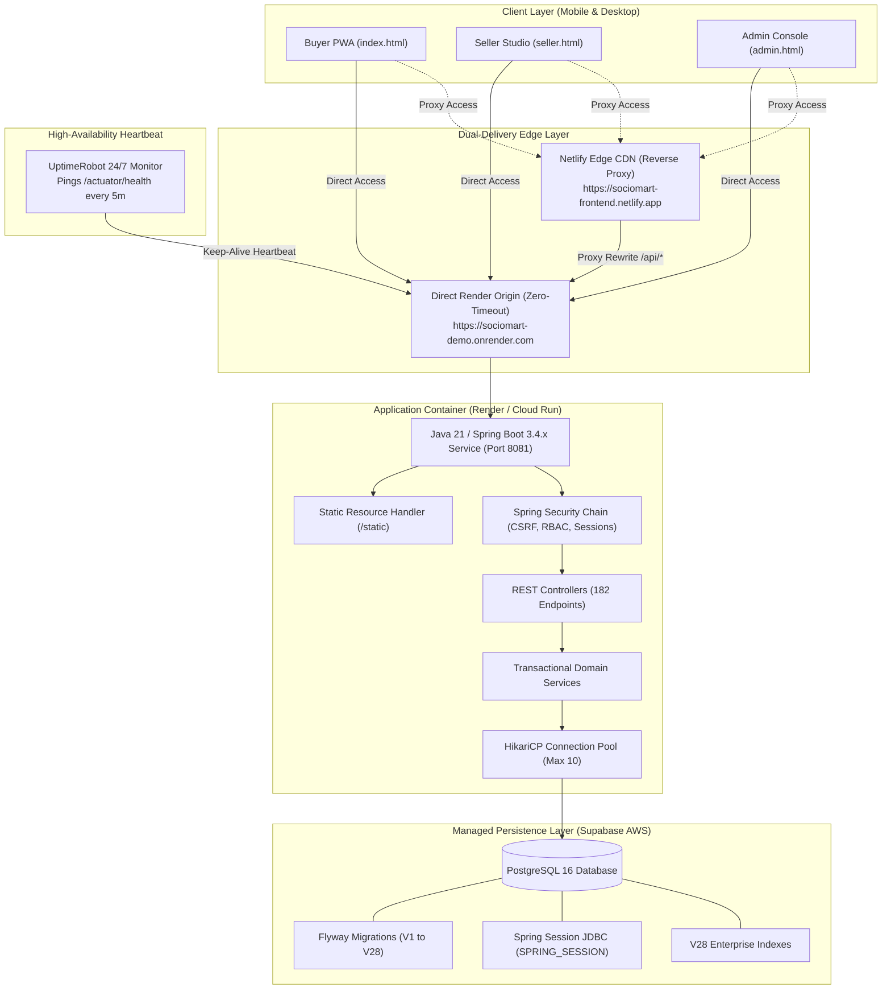
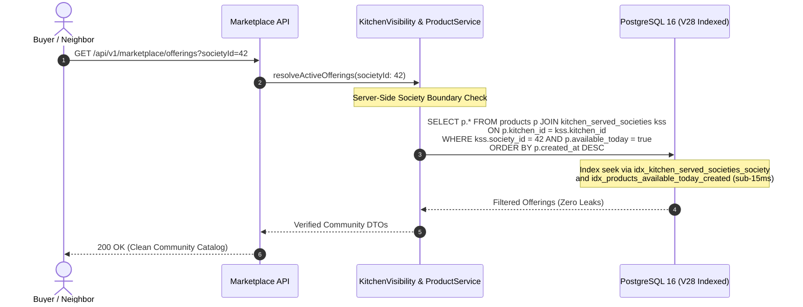
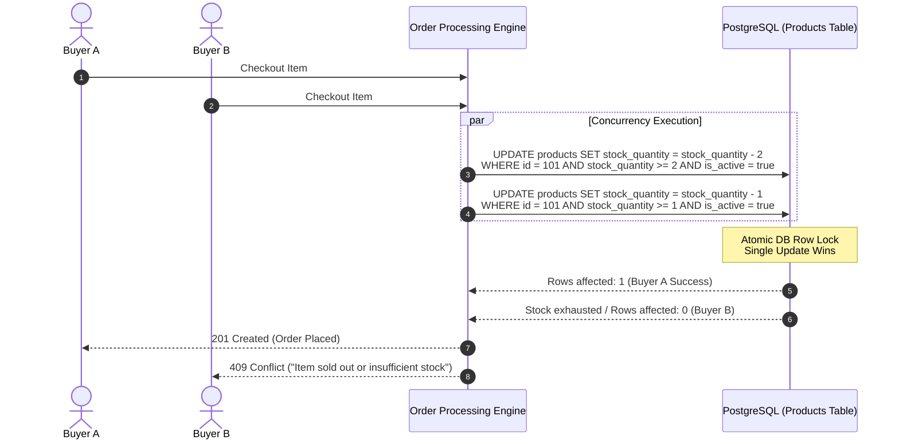

# SocioMart — Enterprise System & Application Architecture

This document provides the authoritative, end-to-end architectural specification of SocioMart, detailing the system topology, multi-society data isolation, concurrency models, database performance engineering, security boundaries, and high-availability deployment pipelines.

---

## 1. System Architecture Overview

SocioMart is an enterprise-grade, hyper-local community marketplace engineered to connect residents within residential societies with verified home chefs and artisan creators. 

The system utilizes a high-cohesion, low-friction **Modular Monolith** architecture with dual-origin edge delivery:

---

## 2. Dual-Delivery Architecture & Cold-Start Elimination

To guarantee 100% uptime, zero loading latency, and complete resilience against cloud provider limits, SocioMart implements a **Dual-Delivery Hosting Model**:

1. **Direct Spring Boot Origin (`https://sociomart-demo.onrender.com`)**:
   - The Spring Boot Docker container packages both the REST API and the entire static frontend (`src/main/resources/static`).
   - Requests served directly through this origin eliminate reverse-proxy hops, completely bypassing proxy timeouts.
2. **24/7 Active Heartbeat (UptimeRobot)**:
   - An external synthetic monitoring probe pings `/actuator/health` or `/` every 5 minutes.
   - Prevents the Render free-tier container from entering sleep mode, eliminating cold-start latency.
3. **Netlify Edge CDN (`https://sociomart-frontend.netlify.app`)**:
   - Serves as a globally distributed static edge cache.
   - Transparently rewrites `/api/*` to the active Render service origin with enhanced client-side retry logic.

---

## 3. Multi-Society Data Isolation Architecture

SocioMart enforces strict multi-tenant community isolation at both the query level and the authorization filter level:

### Server-Side IDOR & Cross-Community Defenses
- **Buyer Isolation**: Offerings are constrained by the buyer's selected society; kitchens that do not actively register coverage for `societyId` are pruned from query execution.
- **Seller Isolation**: All offering mutations verify `product.kitchen.owner.id == authenticatedUser.id`.
- **Admin Isolation**: Master location hierarchies (Area → Society) require `ROLE_ADMIN` with database constraint verification.

---

## 4. Concurrency & Inventory Integrity

To ensure zero overselling during peak pre-order launches and high-concurrency ordering bursts, SocioMart uses atomic SQL decrements combined with pessimistic row locking:

---

## 5. Database Performance & Indexing Strategy (Flyway V28)

Database schema evolution is managed via version-controlled Flyway migrations with strict `ddl-auto=validate` enforcement.

### Critical Indexes in Migration `V28__enterprise_scalability_indexes.sql`:
1. **`idx_kitchen_served_societies_society`** on `kitchen_served_societies (society_id)`:
   - Converts multi-society marketplace filtering from $O(N)$ full-table scans to $O(\log N)$ B-tree seeks.
2. **`idx_products_available_today_created`** on `products (available_today, created_at DESC)`:
   - Optimizes high-throughput catalog listing queries by ignoring archived or draft items.
3. **`idx_users_role_approval`** on `users (role, seller_approval_status)`:
   - Accelerates admin seller onboarding workflows and moderation queues.
4. **`idx_orders_status_composite`** on `orders (order_status, payment_status, created_at DESC)`:
   - Accelerates seller earnings calculations and active order lifecycle filtering.

---

## 6. Security Architecture & Threat Defense

| Threat / Vulnerability | SocioMart Mitigation Strategy | Implementation Point |
| :--- | :--- | :--- |
| **Cross-Site Request Forgery (CSRF)** | Double-submit `XSRF-TOKEN` cookie validated against `X-XSRF-TOKEN` header on all mutable methods (`POST`, `PUT`, `DELETE`). | `SecurityConfig.java` |
| **Insecure Direct Object Reference (IDOR)** | Server-side user identity verification on all entity mutations (`sellerId`, `orderId`). | `SellerService.java`, `OrderService.java` |
| **Formula Injection (CSV Injection)** | Prepending single quote (`'`) to any exported field starting with `=`, `+`, `-`, or `@`. | `AdminService.java` |
| **Session Hijacking** | Persistent `SPRING_SESSION` stored in PostgreSQL with `HttpOnly`, `SameSite=Lax`, and `Secure` cookie flags. | `application-prod.properties` |
| **Data-at-Rest Exposure** | AES-256-GCM AEAD encryption on sensitive user data fields. | `DatabaseAEADEncryptor.java` |
| **XSS & Injection Attacks** | Strict Content Security Policy (CSP), HTML entity encoding on render, zero `eval()` usage. | Client UI Framework |

---

## 7. Architecture Decision Records (ADRs)

For in-depth justifications of key architectural decisions, refer to:
* **[ADR-001: Modular Monolith vs Microservices](./adr/ADR-001-modular-monolith-vs-microservices.md)**
* **[ADR-002: Dual-Backend Evaluation & Netlify Independence](./adr/ADR-002-dual-backend-evaluation-and-netlify-independence.md)**
* **[ADR-003: Multi-Society Data Isolation & Authorization](./adr/ADR-003-multi-society-data-isolation-and-authorization.md)**
* **[ADR-004: Concurrency & Transaction Pool Routing](./adr/ADR-004-concurrency-and-transaction-pool-routing.md)**
* **[ADR-005: Database Indexing & Capacity Scaling](./adr/ADR-005-database-indexing-and-capacity-scaling.md)**

---

## 8. Operational & SRE Documentation

* **[Capacity Planning Guide (1k–100k Users)](./SCALABILITY.md)**
* **[Disaster Recovery & Backup Procedures](./DISASTER_RECOVERY.md)**
* **[Incident Response & Operational Runbooks](./RUNBOOKS.md)**
* **[REST API Reference (182 Endpoints)](./API_REFERENCE.md)**
