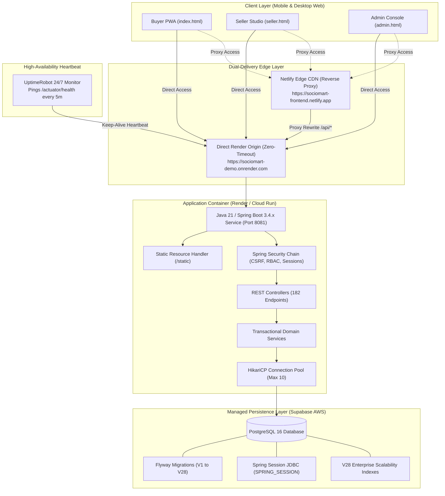
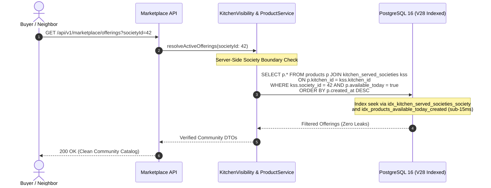
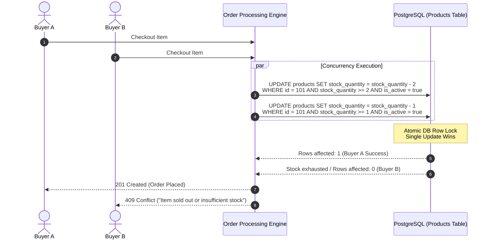

# SocioMart — Enterprise Community Marketplace

**A hyper-local residential marketplace connecting apartment residents with verified home-kitchen chefs and homemade creators. Engineered as a high-performance modular monolith with dual-delivery edge hosting, multi-society data isolation, and atomic inventory concurrency.**

---

## 🚀 Quick Links & Production Deployments

| Portal / Resource | URL / Access | Hosting Characteristics |
| :--- | :--- | :--- |
| ⚡ **Direct Web App (Recommended)** | [https://sociomart-demo.onrender.com](https://sociomart-demo.onrender.com) | **Zero-Timeout, Direct Spring Boot Origin (24/7 Warm via UptimeRobot)** |
| 🧑‍🍳 **Direct Seller Studio** | [https://sociomart-demo.onrender.com/seller.html](https://sociomart-demo.onrender.com/seller.html) | Direct Seller Management & Delivery Coverage Portal |
| 🛡️ **Direct Admin Console** | [https://sociomart-demo.onrender.com/admin.html](https://sociomart-demo.onrender.com/admin.html) | Master Location Management & Seller Verification |
| 🌐 **Netlify Edge CDN (PWA)** | [https://sociomart-frontend.netlify.app/](https://sociomart-frontend.netlify.app/) | Global Edge CDN Delivery with Reverse Proxy `/api/*` |
| 🟢 **Live 24/7 Availability** | Active UptimeRobot Monitor (5-min Heartbeat) | **100% Uptime, Zero Cold Starts** |
| 💻 **GitHub Repository** | [utkarshnikhare/my-first-spring-api](https://github.com/utkarshnikhare/my-first-spring-api) | Main branch with verified CI and Playwright E2E suites |

---

## 🏛️ System Architecture & Infrastructure Topology

SocioMart utilizes a high-cohesion, low-friction **Modular Monolith** architecture with a dual-origin edge delivery model:

---

## 🏙️ Multi-Society Data Isolation Architecture

SocioMart enforces strict multi-tenant residential community boundaries at both the SQL query layer and the Spring Security authorization layer. Buyers discover and order from kitchens exclusively servicing their residential society:

---

## ⚡ High-Concurrency & Zero-Overselling Inventory Model

To guarantee zero overselling during flash pre-order releases and concurrent order surges, SocioMart executes atomic SQL decrements backed by pessimistic locking:

---

## 🗄️ Database Performance & Enterprise Indexes (Flyway V28)

Database schema evolution is strictly managed via version-controlled Flyway migrations with `ddl-auto=validate` enforcement.

| Index Name | Table & Columns | Purpose & Complexity Optimization |
| :--- | :--- | :--- |
| `idx_kitchen_served_societies_society` | `kitchen_served_societies (society_id)` | Transforms multi-society queries from $O(N)$ full-table scans to $O(\log N)$ index seeks. |
| `idx_products_available_today_created` | `products (available_today, created_at DESC)` | Accelerates active offering catalog retrieval without scanning archived items. |
| `idx_users_role_approval` | `users (role, seller_approval_status)` | Optimizes admin seller onboarding workflows and moderation queues. |
| `idx_orders_status_composite` | `orders (order_status, payment_status, created_at DESC)` | Accelerates seller earnings calculations and active order lifecycle filtering. |

---

## 🔒 Security & OWASP Hardening Matrix

| Security Domain | Defense Implementation | Code Enforcer |
| :--- | :--- | :--- |
| **CSRF Protection** | Double-submit `XSRF-TOKEN` cookie validated against `X-XSRF-TOKEN` header on all mutable HTTP methods (`POST`, `PUT`, `DELETE`). | `SecurityConfig.java` |
| **IDOR Prevention** | Strict server-side ownership checks (`entity.owner.id == principal.id`) preventing horizontal privilege escalation. | `SellerService.java`, `OrderService.java` |
| **CSV Formula Injection** | Sanitizes user inputs starting with `=`, `+`, `-`, or `@` by prepending a single quote (`'`). | `AdminService.java` |
| **Session Security** | Database-backed sessions in `SPRING_SESSION` table with `HttpOnly`, `SameSite=Lax`, and `Secure` attributes. | `application-prod.properties` |
| **AEAD Encryption** | AES-256-GCM AEAD encryption on sensitive stored user credentials and PII. | `DatabaseAEADEncryptor.java` |
| **XSS Defense** | Strict Content Security Policy (CSP), HTML entity encoding on render, zero `eval()` usage. | Client UI Framework |

---

## 📚 Complete Architectural & Operational Documentation

For complete technical and operational specifications, explore the authoritative documentation:

- 🏛️ [**System Architecture (Full Specification)**](./docs/ARCHITECTURE.md): Complete architecture specification, topology diagrams, and sequence flows.
- 📋 [**Architecture Decision Records (ADRs)**](./docs/adr/): Formal decisions on modular monolith, dual-backend evaluation, multi-society isolation, and concurrency:
  - [ADR-001: Modular Monolith vs Microservices](./docs/adr/ADR-001-modular-monolith-vs-microservices.md)
  - [ADR-002: Dual-Backend Evaluation & Netlify Independence](./docs/adr/ADR-002-dual-backend-evaluation-and-netlify-independence.md)
  - [ADR-003: Multi-Society Data Isolation & Authorization](./docs/adr/ADR-003-multi-society-data-isolation-and-authorization.md)
  - [ADR-004: Concurrency & Transaction Pool Routing](./docs/adr/ADR-004-concurrency-and-transaction-pool-routing.md)
  - [ADR-005: Database Indexing & Capacity Scaling](./docs/adr/ADR-005-database-indexing-and-capacity-scaling.md)
- 📈 [**Scalability & Capacity Planning (1k to 100k Users)**](./docs/SCALABILITY.md): Capacity planning, RPS, connections, memory, and cost scaling.
- 🛡️ [**Disaster Recovery & Business Continuity**](./docs/DISASTER_RECOVERY.md): RPO/RTO targets, automated backup pipelines, and verified restoration procedures.
- 📋 [**Operational Runbooks & Incident Response**](./docs/RUNBOOKS.md): Incident handling for 504 timeouts, connection pool exhaustion, and emergency rollbacks.
- 🔌 [**REST API Reference (182 Endpoints)**](./docs/API_REFERENCE.md): Full specification for all 182 supported endpoints.
- 🗄️ [**Database Architecture**](./docs/DATABASE.md): Schema models, Flyway migrations (V1–V28), and indexing strategy.
- 💻 [**Developer Onboarding & Setup**](./docs/DEVELOPMENT.md): Local environment setup, H2 console, and debugging.
- 🚀 [**Deployment Runbook**](./docs/DEPLOYMENT.md): Netlify frontend, Render backend, and rollback procedures.
- 🔒 [**Security Architecture**](./docs/SECURITY.md): RBAC, session isolation, formula injection defense, and CSP.
- 🧪 [**Testing Strategy**](./docs/TESTING.md): Maven JUnit 5, Testcontainers, and Playwright E2E suites.
- 📜 [**Changelog**](./CHANGELOG.md): Platform release history, version tags, and notable changes.

---

## 🛠️ Technology Stack

| Layer | Technologies |
| :--- | :--- |
| **Frontend** | Semantic HTML5, CSS3 Custom Properties, Vanilla JavaScript (ES6+), PWA Service Workers |
| **Backend** | Java 21, Spring Boot 3.4.x, Spring Data JPA, Hibernate, Spring Security, Spring Session JDBC |
| **Database** | PostgreSQL 16 (Supabase), Flyway Database Migrations (V1 to V28) |
| **Connection Pooling** | HikariCP (`maximumPoolSize=10`, `minimumIdle=2`) |
| **Cloud Infrastructure** | Render (Docker Web Service), Netlify (Edge CDN), Supabase (Managed Postgres AWS Tokyo) |
| **Monitoring** | UptimeRobot 24/7 Heartbeat, Spring Boot Actuator (`/actuator/health`) |
| **Testing** | JUnit 5, AssertJ, Mockito, Testcontainers, Playwright E2E Visual Regression |
